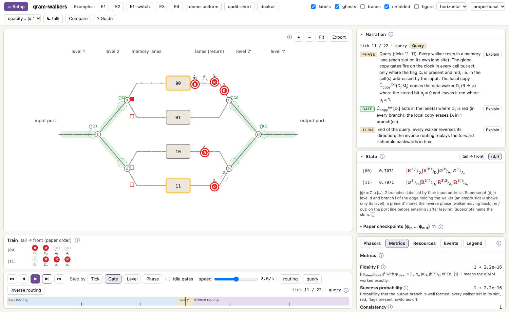

# qram-walkers

Interactive simulator and visualiser of the **quantum-walker quantum RAM**
(De Riso, Catalano, Lloyd, Giovannetti, De Santis — arXiv:2508.02855).

Watch a train of quantum walkers carry a superposition of addresses down a binary
tree, pick up the stored bits at the memory cells and come back coherently — one
clock tick at a time. Choose the architecture variant (basic long-range, backup
short-range, qudit, dual-rail), the input superposition, the memory contents and the
noise model; read the state in the paper's ket notation; measure fidelity and
resources.

The protocol is described in the letter arXiv:2508.02855 (*the paper*) and in a companion
*technical paper* (in preparation), with the gate tables of every variant; the guide cites
them as "the paper" and "technical paper, §Section".



## Install and run

* **In the browser, nothing to install:** <https://prppgn.github.io/qram-walkers/>.
* **The app** for macOS, Windows and Linux: download it from the
  [latest release](https://github.com/prppgn/qram-walkers/releases/latest). It is not signed with
  a paid certificate, so the first opening shows a warning; [INSTALL.md](INSTALL.md) says what
  to click.
* **From the source code**, with [uv](https://docs.astral.sh/uv/) and [Node.js](https://nodejs.org)
  with [pnpm](https://pnpm.io) (on macOS: `brew install uv node pnpm`):

  ```bash
  git clone https://github.com/prppgn/qram-walkers.git
  cd qram-walkers/engine
  uv run qramsim app
  ```

Step by step, with troubleshooting: **[INSTALL.md](INSTALL.md)**.

## What it does

* **All six variants**: basic and backup, qudit short and long range, dual-rail basic and
  backup, checked against Eq. (1) of the paper exactly.
* **Any input**: superpositions of addresses with your own amplitudes, any memory contents.
* **The state at every tick**, in the paper's ket notation, with a sentence for every event.
* **Noise**: loss, flips, dephasing, depolarising, gate and clock errors, memory errors and coherent
  errors, sampled with quantum jumps; ensembles and sweeps.
* **Metrics and resources**: fidelity, success, consistency, entanglement entropy, heralded
  fidelity, gate counts and depths beside the paper's formulas.
* **Comparison** of two variants on one clock.
* **Exports**: SVG, PNG, TikZ, video, trajectory data; a figure mode for papers and a theme for talks.
* **Command line and Python API** for research runs: `qramsim run`, `sweep`, `scaling`, `video`.
* **Three ways to run it**: in the browser with nothing to install, as an app with its own
  window, or from the source code with the command line.

## Documentation

The guide is inside the program: click **? Guide**. Its sources are in
[`docs/user-guide/`](docs/user-guide), written for the program's renderer, so GitHub shows them with some
raw anchors and formulas:

| page | contents |
|---|---|
| [Start](docs/user-guide/start.md) | a two-minute tour, and where to find what |
| [Protocol](docs/user-guide/protocol.md) | how the qRAM works, as simulated here |
| [Variants](docs/user-guide/variants.md) | the six variants and their resources |
| [Gates](docs/user-guide/gates.md) | every gate, with formulas |
| [Metrics](docs/user-guide/metrics.md) | what the numbers mean |
| [Noise](docs/user-guide/noise.md) | every noise model |
| [Interface](docs/user-guide/ui.md) | what the drawings mean |
| [Controls](docs/user-guide/controls.md) | every button, field and menu |
| [Command line](docs/user-guide/cli.md) | every command, and the Python API |
| [FAQ](docs/user-guide/faq.md) | why the results look the way they do |

## Layout

```
engine/    Python package `qramsim`: the simulation, the only place where physics lives
viewer/    web interface (TypeScript, React, SVG): renders what the engine computes
docs/      the user guide (also inside the program) and its figures
packaging/ the installers of the app (macOS, Windows, Linux)
icons/     the application icon
```

`qram-walkers.command`, `qram-walkers.bat` and `qram-walkers.sh` start the program with a
double click. How to run the tests and how the code is organised: **[CONTRIBUTING.md](CONTRIBUTING.md)**.

## Citation

If you use the program, please cite the paper:

G. De Riso, G. Catalano, S. Lloyd, V. Giovannetti, D. De Santis,
*A resource-efficient quantum-walker Quantum RAM*, arXiv:2508.02855 (2025).

[`CITATION.cff`](CITATION.cff) has the entries for the paper and for the software (GitHub shows
them under "Cite this repository").

## Licence

MIT, see [LICENSE](LICENSE).
